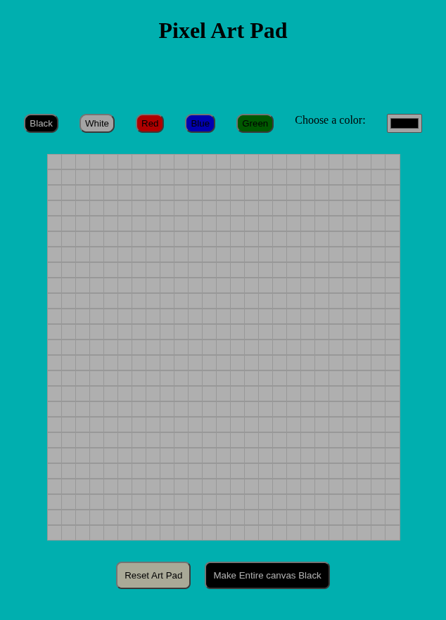
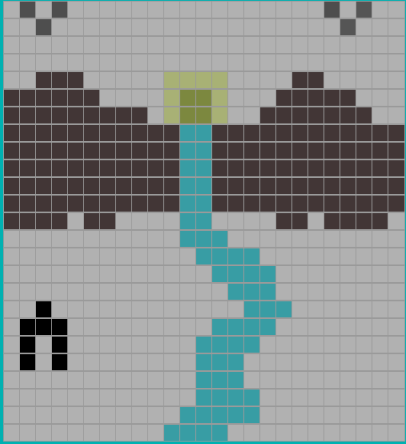

# What is it
It is just art pad for drawing in pixels

# What can u do here
You can make what ever art you want in 25 X 25 pixel field with any color you want

# Why did I built this?
- To lern javscript DOM 
- I learned all this from workshops.hackclub.com

# How I built this?
- I thought of making something basic which will teach me fundamentals 
- As I was now able to understand basic concepts in javascript DOM I decided to follow workshop of this -- > https://workshops.hackclub.com/pixel_art_pad/
- And I didn't took help of any AI as this was just learning

# Screenshots

